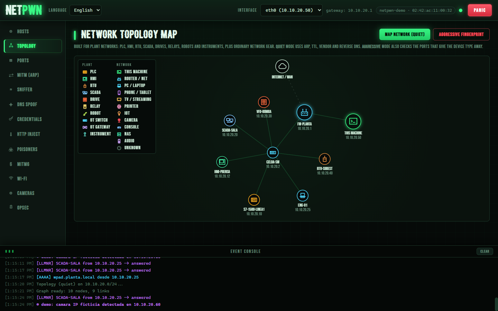
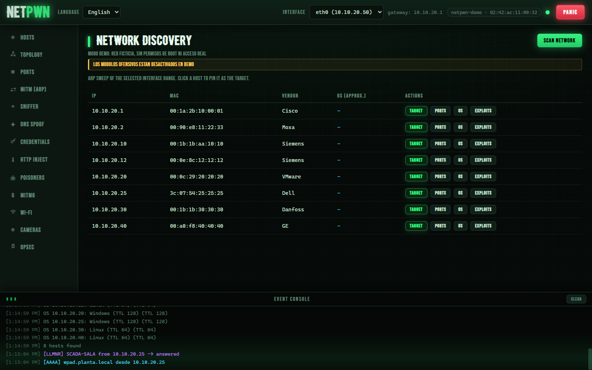
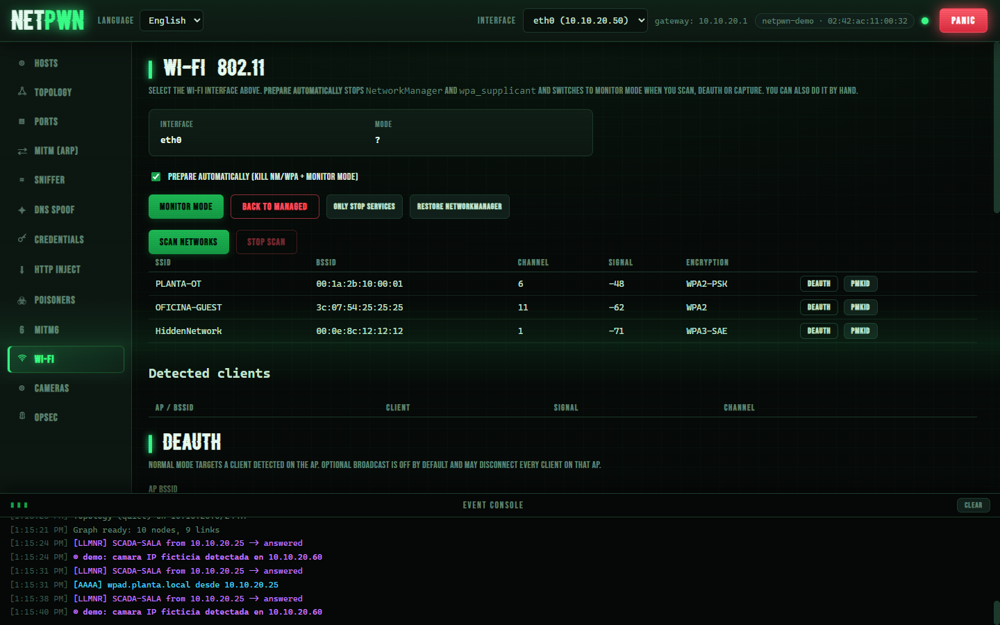

<div align="center">

# ⚡ NetPwn

**Graphical network security auditing suite with a web UI.** Discover the
network, scan, set up a MITM, capture traffic and audit — all from your
browser, like *bettercap* but one-click.

[](https://github.com/letox4/netpwn/actions/workflows/ci.yml)
[](LICENSE)
[](pyproject.toml)
[](#)

[Español](README.md) · [Responsible use](DISCLAIMER.md) · [Test checklist](docs/TEST-CHECKLIST.md)



</div>

> [!WARNING]
> **Dual-use tool**: only use it on networks you own or have **explicit
> written authorization** to test. Intercepting traffic or capturing
> credentials without permission is illegal. Read the [disclaimer](DISCLAIMER.md).

## ⚡ Try it in 10 seconds

```bash
python netpwn.py --demo
```

Boots with a **fictional network** (a small industrial plant) and live events:
hosts, ports, topology and simulated activity — no root, no real network, any
OS. Perfect for a quick look before setting up your own lab.

## ✨ Features

| Module | What it does |
|--------|--------------|
| **Hosts** | ARP sweep + OS fingerprinting (TTL, vendor, ports) |
| **Ports** | TCP connect or **SYN stealth** (half-open) + **low noise** jitter mode |
| **Topology** | Interactive network graph with per-node evidence |
| **MITM (ARP)** | ARP spoofing + IP forwarding to audit traffic |
| **Sniffer** | Live packet capture with optional BPF filter |
| **DNS Spoof** | Answers DNS queries with controlled IPs |
| **Credentials** | Basic, forms, cookies, Bearer, API keys, FTP, NTLMSSP; **memory-only** + export |
| **HTTP Inject** | Transparent proxy injecting JS/HTML + sslstrip-lite |
| **Poisoners** | **LLMNR / NBT-NS / mDNS** (Responder style) |
| **WPAD** | Rogue PAC + proxy logging hosts/URLs/plaintext creds |
| **mitm6** | Router Advertisements + IPv6 DNS (mitm6 style) |
| **Wi-Fi** | 802.11 scan, (low-noise) deauth, EAPOL handshakes and **PMKID** → hashcat |
| **Cameras** | IP camera auditing: creds, RTSP, ONVIF, firmware |
| **OPSEC** | Identity profiles (hostname + real-OUI MAC) to audit YOUR network inventory posture |
| **🆘 PANIC** | Kill switch: stop everything, flush iptables rules, restore identity |

Typical audit flow: **scan hosts → pin a target → start MITM → enable
Sniffer / DNS / Credentials**.

## 📸 Screenshots

| Discovery & ports | Wi-Fi |
|---|---|
|  |  |

## 🚀 Installation (Kali Linux)

```bash
git clone https://github.com/letox4/netpwn
cd netpwn
chmod +x run.sh
./run.sh          # creates the venv, installs deps, starts with sudo
```

Open <http://127.0.0.1:8000>. Root is required for raw sockets (the script
calls `sudo` itself).

### Manual

```bash
python3 -m venv venv && source venv/bin/activate
pip install -r requirements.txt
python netpwn.py --host 127.0.0.1 --port 8000
```

Optional dependency for hashcat conversion: `sudo apt install hcxtools`.

## 🧠 How it works inside

```
app/
  main.py            # REST API + WebSocket (FastAPI)
  core/              # event bus, tagged firewall rules, snapshot/restore,
                     # automatic cleanup (atexit/signals), demo mode
  modules/           # discovery, portscan, arp, sniff, dns, creds, httpinject,
                     # poison, wpad, mitm6, wifi, opsec, topology, cameras
  static/            # web UI (vanilla JS, bilingual)
tests/               # unit tests (pytest, no network needed)
```

- **Backend:** FastAPI + [scapy](https://scapy.net/). A thread-safe event bus
  pushes everything to the UI over a **WebSocket** in real time.
- **Frontend:** dependency-free HTML/CSS/JS served by the backend itself.
- **Hygiene:** every firewall rule is tagged with the `netpwn` comment;
  cleanup (PANIC, `atexit`, `SIGINT`/`SIGTERM`) removes **only our rules**,
  even after a crash. Orphaned rules are detected and reported at startup.
- **Demo mode:** `NETPWN_DEMO=1` replaces the system with a fictional
  network, so it runs on Windows/macOS and CI.

## 📝 Module notes

### HTTP Inject
Requires **ARP MITM** active. Installs an `iptables REDIRECT` rule to divert
TCP/80 to the proxy, injects your payload before `</body>` and, with
sslstrip, rewrites `https://` → `http://` and strips HSTS/CSP. **It does not
decrypt HTTPS**; it only prevents the TLS upgrade from cleartext pages. The
rule is removed on stop.

### Poisoners (LLMNR / NBT-NS / mDNS) + WPAD
Answers multicast name queries the DNS can't resolve, **without touching
ARP**: quieter, and the classic way to **demonstrate** how easily credentials
leak on a misconfigured Windows network. With WPAD enabled, the proxy logs
hosts, URLs and cleartext credentials.

### mitm6 (IPv6)
Announces your machine as IPv6 router and DNS via Router Advertisements —
the classic way to **prove that a well-watched IPv4 isn't enough** when
nobody watches IPv6. Aggressive: use on a lab segment.

### Credentials
Everything stays **in memory only** (never written to disk), with JSON export
and a clear button. Detects HTTP Basic, forms, session cookies, Bearer, API
keys, FTP and NTLMSSP (for `ntlmrelayx` in the audit workflow).

### Wi-Fi
Managed monitor mode (NetworkManager + interferers), 802.11 scanning,
**low-noise** deauth (short bursts + jitter), **EAPOL handshake** capture
(parallel deauth forces reconnection) and client-less **PMKID**. Automatic
conversion to hashcat format 22000 with `hcxpcapngtool`.

### OPSEC & PANIC
The OPSEC panel lets you **verify from the other side** what gives away a
novice auditor (a `kali` hostname, a locally-administered MAC bit, telltale
profiles) and apply clean identities with real-vendor OUIs. Everything is
recorded so the **PANIC button** restores hostname, MAC, `ip_forward` and
firewall rules in one click.

## 🤝 Contributing & testing

- [Full test checklist](docs/TEST-CHECKLIST.md) (includes what can only be
  tested with real hardware on Kali).
- [Contributing guide](CONTRIBUTING.md) and [security policy](SECURITY.md).

## 📄 License

[GPL-3.0](LICENSE) © letox4. See [DISCLAIMER.md](DISCLAIMER.md) before use.
