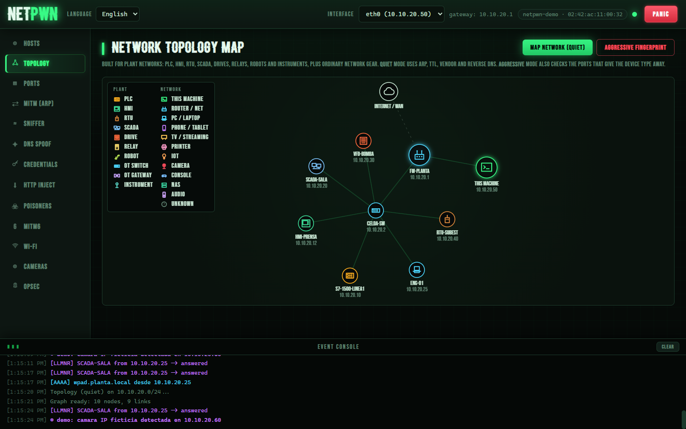
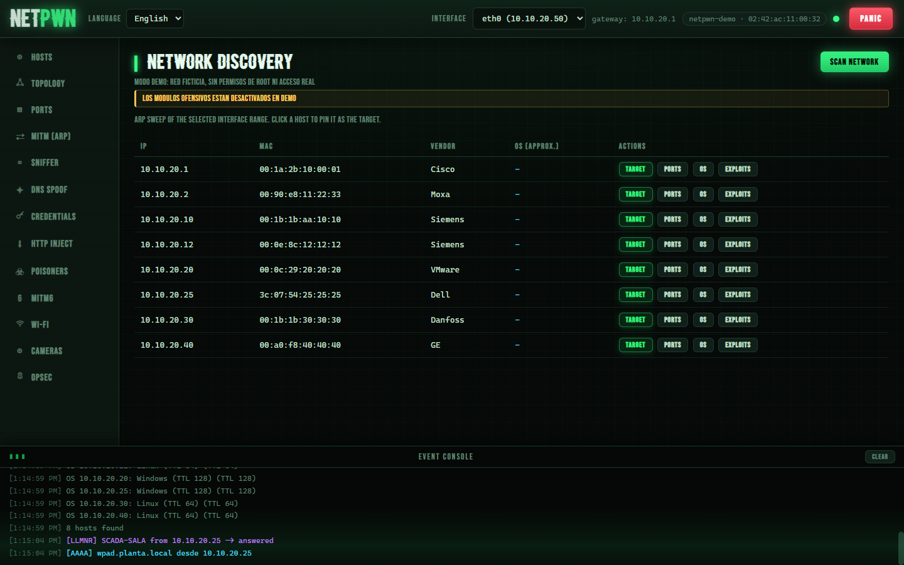
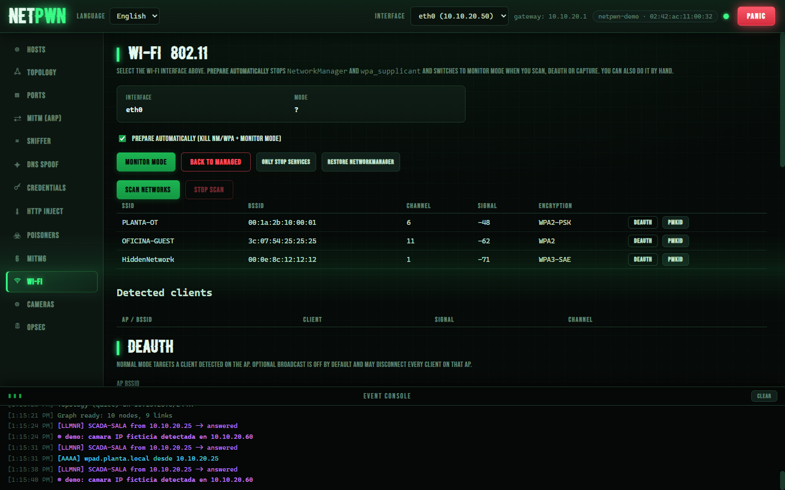

<div align="center">

# ⚡ NetPwn

**Suite gráfica de auditoría de redes con interfaz web.** Descubre la red,
escanea, monta un MITM, captura tráfico y audita — todo desde el navegador,
al estilo *bettercap* pero con un clic.

[](https://github.com/letox4/netpwn/actions/workflows/ci.yml)
[](LICENSE)
[](pyproject.toml)
[](#)

[English](README.en.md) · [Uso responsable](DISCLAIMER.md) · [Checklist de pruebas](docs/TEST-CHECKLIST.md)



</div>

> [!WARNING]
> Herramienta de **doble uso**: úsala solo en redes propias o con
> **autorización expresa por escrito**. Interceptar tráfico o capturar
> credenciales sin permiso es ilegal. Lee el [disclaimer](DISCLAIMER.md).

## ⚡ Pruébala en 10 segundos (sin instalar nada raro)

```bash
python netpwn.py --demo
```

Arranca con una **red ficticia** (una planta industrial pequeña) y eventos en
vivo: hosts, puertos, topología y actividad simulada — sin root, sin red real,
en cualquier sistema operativo. Ideal para ver qué hace antes de montar el
laboratorio.

## ✨ Funciones

| Módulo | Qué hace |
|--------|----------|
| **Hosts** | Barrido ARP + fingerprint de SO (TTL, fabricante, puertos) |
| **Puertos** | TCP connect o **SYN stealth** (half-open) + modo **low noise** con jitter |
| **Topología** | Grafo interactivo de la red con evidencia por nodo |
| **MITM (ARP)** | ARP spoofing + reenvío IP para auditar el tráfico |
| **Sniffer** | Captura de paquetes en vivo con filtro BPF opcional |
| **DNS Spoof** | Responde consultas DNS con IPs controladas |
| **Credenciales** | Basic, formularios, cookies, Bearer, API keys, FTP, NTLMSSP; **solo en memoria** + export |
| **HTTP Inject** | Proxy transparente que inyecta JS/HTML y hace sslstrip-lite |
| **Poisoners** | **LLMNR / NBT-NS / mDNS** (estilo Responder) |
| **WPAD** | PAC + proxy que registra hosts/URLs/creds en claro |
| **mitm6** | Router Advertisements + DNS IPv6 (estilo mitm6) |
| **Wi-Fi** | Escaneo 802.11, deauth (low noise), handshakes EAPOL y **PMKID** → hashcat |
| **Cámaras** | Auditoría de cámaras IP: credenciales, RTSP, ONVIF, firmware |
| **OPSEC** | Perfiles de identidad (hostname + MAC con OUI real) para auditar la postura de inventario de TU red |
| **🆘 PÁNICO** | Kill switch: para todo, borra reglas iptables y restaura identidad |

El flujo típico de auditoría: **Escanear hosts → marcar un objetivo → iniciar
MITM → activar Sniffer / DNS / Credenciales**.

## 📸 Capturas

| Descubrimiento y puertos | Wi-Fi |
|---|---|
|  |  |

## 🚀 Instalación (Kali Linux)

```bash
git clone https://github.com/letox4/netpwn
cd netpwn
chmod +x run.sh
./run.sh          # crea el venv, instala deps y arranca con sudo
```

Abre <http://127.0.0.1:8000>. Requiere root para los sockets raw (el script
usa `sudo` él solo).

### Manual

```bash
python3 -m venv venv && source venv/bin/activate
pip install -r requirements.txt
python netpwn.py --host 127.0.0.1 --port 8000
```

Dependencia opcional para convertir capturas a hashcat: `sudo apt install hcxtools`.

## 🧠 Cómo funciona por dentro

```
app/
  main.py            # API REST + WebSocket (FastAPI)
  core/              # bus de eventos, firewall etiquetado, snapshot/restore,
                     # limpieza automática (atexit/señales), modo demo
  modules/           # discovery, portscan, arp, sniff, dns, creds, httpinject,
                     # poison, wpad, mitm6, wifi, opsec, topology, cameras
  static/            # interfaz web (vanilla JS, bilingüe)
tests/               # tests unitarios (pytest, sin red)
```

- **Backend:** FastAPI + [scapy](https://scapy.net/). Un bus de eventos
  thread-safe empuja todo lo que ocurre a la interfaz por **WebSocket** en
  tiempo real.
- **Frontend:** HTML/CSS/JS sin dependencias, servido por el propio backend.
- **Higiene:** todas las reglas de firewall llevan el comentario `netpwn`;
  la limpieza (PÁNICO, `atexit`, `SIGINT`/`SIGTERM`) borra **solo lo nostro**,
  incluso tras un crash. Al arrancar detecta restos huérfanos y avisa.
- **Modo demo:** `NETPWN_DEMO=1` sustituye el sistema por una red ficticia —
  así puede correr en Windows/macOS y en CI.

## 📝 Notas por módulo

### HTTP Inject
Necesita el **MITM ARP activo**. Instala una regla `iptables REDIRECT` para
desviar el TCP/80 al proxy, inyecta tu payload antes de `</body>` y, con
sslstrip, reescribe `https://` → `http://` y elimina HSTS/CSP. **No descifra
HTTPS**; solo evita el *upgrade* a TLS desde páginas en claro. La regla se
elimina sola al detener.

### Poisoners (LLMNR / NBT-NS / mDNS) + WPAD
Responde consultas multicast de nombres que el DNS no resuelve, **sin tocar
ARP**: menos ruido, muy efectivo para **demostrar** a un cliente lo fácil que
es capturar credenciales en una red Windows mal configurada. Con WPAD activo,
el proxy registra hosts, URLs y creds en claro.

### mitm6 (IPv6)
Anuncia tu máquina como router y DNS IPv6 vía Router Advertisements — la
manera clásica de **probar que IPv4 bien vigilado no basta** si nadie mira
IPv6. Agresivo: requiere segmento de laboratorio.

### Credenciales
Todo se guarda **solo en memoria** (nunca a disco), con export JSON y botón
de limpiar. Detecta HTTP Basic, formularios, cookies de sesión, Bearer, API
keys, FTP y NTLMSSP (para relays con `ntlmrelayx` en el flujo de auditoría).

### Wi-Fi
Modo monitor gestionado (NetworkManager + interferentes), escaneo 802.11,
deauth **low noise** (burst corto + jitter), captura de **handshakes EAPOL**
(con deauth en paralelo para forzar la reconexión) y **PMKID** sin cliente.
Conversión automática a formato hashcat 22000 con `hcxpcapngtool`.

### OPSEC y PÁNICO
El panel OPSEC permite **verificar desde el otro lado** qué delata a un
auditor novato (hostname `kali`, MAC con bit locally-administered, perfiles
delatorios) y aplicar identidades limpias con OUI de fabricante real. Todo
queda guardado para que el **botón de PÁNICO** restaure hostname, MAC,
`ip_forward` y reglas de firewall en un clic.

## 🤝 Contribuir y testing

- [Checklist completo de pruebas](docs/TEST-CHECKLIST.md) (incluye lo que
  solo se puede probar con hardware real en Kali).
- [Guía de contribución](CONTRIBUTING.md) y [política de seguridad](SECURITY.md).

## 📄 Licencia

[GPL-3.0](LICENSE) © letox4. Ver [DISCLAIMER.md](DISCLAIMER.md) antes de usar.
